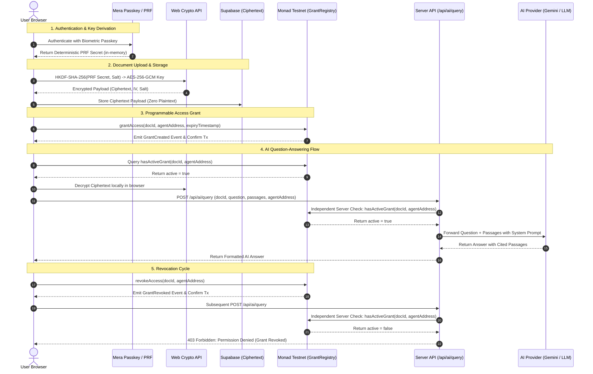

# VaultMind

> **Your data. Your AI. Your permission.**

VaultMind is a privacy-first AI memory vault that empowers users to retain absolute cryptographic and programmable ownership over the documents they share with artificial intelligence agents.

Built for the **Metropolis Hackathon on Monad** (Track 4: *Trust, Identity & AI Infrastructure*), VaultMind fuses **browser-side passkey encryption (WebAuthn PRF)**, **tamper-evident onchain access governance on Monad Testnet**, and **independent server-side permission validation** before any AI question-answering inference occurs.

---

## Table of Contents

- [1. Overview & Vision](#1-overview--vision)
- [2. Key Features](#2-key-features)
- [3. Problem & Solution](#3-problem--solution)
- [4. Architecture & System Design](#4-architecture--system-design)
- [5. Technologies Used](#5-technologies-used)
- [6. Project Structure](#6-project-structure)
- [7. Prerequisites](#7-prerequisites)
- [8. Local Installation & Setup](#8-local-installation--setup)
- [9. Environment Variable Reference](#9-environment-variable-reference)
- [10. Supabase Database Setup](#10-supabase-database-setup)
- [11. Smart Contract Documentation](#11-smart-contract-documentation)
- [12. AI Question-Answering Workflow](#12-ai-question-answering-workflow)
- [13. Running & Testing](#13-running--testing)
- [14. End-to-End Demo Walkthrough](#14-end-to-end-demo-walkthrough)
- [15. Security & Cryptographic Analysis](#15-security--cryptographic-analysis)
- [16. Known Limitations & Roadmap](#16-known-limitations--roadmap)
- [17. Hackathon Context & Tracks](#17-hackathon-context--tracks)
- [18. Contributing & Licensing](#18-contributing--licensing)
- [19. Credits & Useful Links](#19-credits--useful-links)

---

## 1. Overview & Vision

Modern knowledge workers and enterprises want AI assistants to help analyze contracts, personal notes, medical records, and proprietary research. However, doing so traditionally means uploading plaintext documents to cloud databases where access controls are opaque, revocation is illusory, and data breaches are catastrophic.

**VaultMind redefines this paradigm:**
1. **Passkey-Derived Secrets**: You sign in using biometric passkeys (TouchID, Windows Hello, or hardware security keys) using the Mera SDK. Using the WebAuthn PRF (`hmac-secret`) extension, your authenticator evaluates a deterministic master secret kept exclusively in memory.
2. **Browser-Side Encryption**: Your text documents are encrypted directly in your browser using standard AES-256-GCM. Plaintext never touches Supabase or any remote server.
3. **Onchain Access Control on Monad**: When you wish to let an AI agent answer questions about your document, you grant time-limited access via a Solidity smart contract deployed to the Monad blockchain.
4. **Independent Permission Enforcement**: Before an AI model processes your document, both the frontend and our server-side API independently query the Monad contract to ensure your grant is currently active, unexpired, and not revoked.
5. **Instant Revocation**: When you revoke access onchain, subsequent AI queries are immediately rejected with verifiable blockchain evidence.

---

## 2. Key Features

| Feature | Status | Description |
|---|---|---|
| **Mera Passkey Authentication** | **Implemented** | Authenticates via WebAuthn PRF extension with deterministic cryptographic key derivation and browser-local fallback. |
| **Client-Side AES-256-GCM Encryption** | **Implemented** | Uses Web Crypto API with 16-byte random HKDF salts and 12-byte random initialization vectors (IV/nonce) per document. |
| **Supabase Ciphertext Persistence** | **Implemented** | Persists encrypted payloads (`ciphertext`, `iv`, `salt`) and metadata. Zero plaintext or private keys are stored. |
| **Monad GrantRegistry Contract** | **Live on Testnet** | Solidity contract managing document ownership, time-bounded AI agent grants, and instant owner revocations. |
| **Server-Side Monad Verification** | **Implemented** | API route independently queries `hasActiveGrant` directly on Monad RPC before calling the LLM provider. |
| **AI Q&A with Evidence Citations** | **Implemented** | Supports OpenAI-compatible inference (configured for Google Gemini `gemini-2.5-flash`), attributing answers to specific passages. |
| **Transaction Evidence UI** | **Implemented** | Glassmorphic dashboard displaying onchain transaction hashes, block explorer links, and real-time grant expiry counters. |
| **Revocation Test Workflow** | **Implemented** | Full grant-ask-revoke-reject verification cycle with interactive visual indicators. |
| **Multi-Document Semantic Search** | *Planned* | Encrypted client-side vector search or homomorphic indexing across document libraries. |
| **User-Bound Supabase Auth RLS** | *Planned* | Tying Supabase RLS directly to WebAuthn assertion signatures rather than open ciphertext storage. |

---

## 3. Problem & Solution

### The Privacy Problem with AI Document Tools
Contemporary AI document tools require users to surrender confidentiality. Plaintext documents are stored on third-party servers, embedded into unencrypted vector databases, and made available indefinitely to autonomous agents. Once an agent or tool is integrated, revoking access rarely invalidates cached data or stops unauthorized background processing.

### The VaultMind Solution
VaultMind enforces zero-trust privacy through mathematical separation of storage, encryption, and authorization:
- **Storage Layer (Supabase)** only ever observes random base64 ciphertext, initialization vectors, and salts. Even a total database leak reveals zero document content.
- **Key Layer (Mera Passkey PRF)** derives symmetric keys client-side from hardware authenticators. No passwords, seed phrases, or private encryption keys are ever transmitted over the network.
- **Authorization Layer (Monad Blockchain)** handles time-locked permissions through public smart contracts. Access rights are deterministic, transparent, globally verifiable, and instantly revocable by the document owner.
- **Inference Layer (Server AI Route)** executes strict gatekeeping. If an onchain check fails, the AI provider is never invoked.

### Target Audience
- Privacy-conscious individuals managing sensitive journals, medical documents, or financial notes.
- Web3 developers seeking a reference architecture for passkey PRF key derivation and smart-contract access control.
- Organizations seeking verifiable, auditable AI data access compliance.

---

## 4. Architecture & System Design



### Component Responsibility Matrix

| Component | File Location | Responsibility |
|---|---|---|
| **User Interface** | [`app/page.tsx`](file:///a:/Amar/Projects/Project%2011%20%28Monad%29/app/page.tsx) | Complete glassmorphic control center for authentication, document management, grant creation, revocation, and chat. |
| **Passkey Service** | [`lib/mera.ts`](file:///a:/Amar/Projects/Project%2011%20%28Monad%29/lib/mera.ts) | Interacts with `@category-labs/mera` and WebAuthn PRF extension to derive hardware-backed secrets. |
| **Cryptography** | [`lib/crypto.ts`](file:///a:/Amar/Projects/Project%2011%20%28Monad%29/lib/crypto.ts) | Web Crypto API routines for HKDF-SHA-256 key derivation and AES-256-GCM encryption/decryption. |
| **Persistence Client** | [`lib/supabase.ts`](file:///a:/Amar/Projects/Project%2011%20%28Monad%29/lib/supabase.ts) | CRUD client for storing and retrieving encrypted document payloads from Supabase with localStorage fallback. |
| **Monad Client** | [`lib/monad.ts`](file:///a:/Amar/Projects/Project%2011%20%28Monad%29/lib/monad.ts) | Ethers.js v6 interface querying and executing transactions against `GrantRegistry` on Monad RPC. |
| **Server AI Route** | [`app/api/ai/query/route.ts`](file:///a:/Amar/Projects/Project%2011%20%28Monad%29/app/api/ai/query/route.ts) | Independent server gatekeeper verifying onchain status before calling the configured LLM API. |
| **Smart Contract** | [`contracts/GrantRegistry.sol`](file:///a:/Amar/Projects/Project%2011%20%28Monad%29/contracts/GrantRegistry.sol) | Solidity contract tracking document ownership, time-limited agent access, and instant revocation. |

### Conceptual Distinctions

- **Encryption (Confidentiality)**: Ensures only holders of the passkey-derived symmetric key can read plaintext document contents.
- **Authentication (Identity)**: Establishes user identity and cryptographic session ownership through biometric passkeys.
- **Authorization (Access Rights)**: Governed deterministically onchain by `GrantRegistry.sol` using timestamps and explicit permissions.
- **Audit Records (Integrity)**: Public Monad transaction logs and events (`DocumentRegistered`, `GrantCreated`, `GrantRevoked`) provide an immutable, verifiable history of all permission changes.

---

## 5. Technologies Used

- **[Next.js 14 (App Router)](https://nextjs.org/)**: React framework providing frontend rendering and server-side API routes.
- **[React 18](https://react.dev/)**: Reactive component tree for live state and transaction tracking.
- **[TypeScript 5.5](https://www.typescriptlang.org/)**: Strict static typing across cryptographic interfaces, smart contract bindings, and API routes.
- **[Solidity 0.8.20](https://soliditylang.org/)**: Smart contract language used for the `GrantRegistry` permission manager.
- **[Hardhat 2.22](https://hardhat.org/)**: Ethereum development environment for compiling, testing, and deploying contracts.
- **[Ethers.js v6](https://docs.ethers.org/v6/)**: Blockchain client connecting the browser and server to Monad RPC nodes.
- **[@category-labs/mera](https://mera.category.xyz/)**: SDK for WebAuthn passkey management and PRF extension evaluation.
- **[Web Crypto API](https://developer.mozilla.org/en-US/docs/Web/API/Web_Crypto_API)**: Native browser cryptography engine executing high-speed, hardware-accelerated AES-GCM and HKDF.
- **[Supabase Database](https://supabase.com/)**: Managed PostgreSQL backend persisting ciphertext payloads.
- **[Google Gemini API](https://ai.google.dev/)**: OpenAI-compatible LLM endpoint powering accurate, passage-cited question answering.
- **[Monad Testnet](https://docs.monad.xyz/)**: High-performance, EVM-compatible Layer 1 blockchain hosting the access registry.

---

## 6. Project Structure

```text
A:\Amar\Projects\Project 11 (Monad)
├── app/
│   ├── api/
│   │   └── ai/
│   │       └── query/
│   │           └── route.ts          # Server-side AI route with Monad permission check
│   ├── globals.css                   # Tailwind/CSS custom styles and dark palette
│   ├── layout.tsx                    # Next.js root layout with metadata
│   └── page.tsx                      # Main VaultMind single-page application UI
├── contracts/
│   └── GrantRegistry.sol             # Monad Solidity grant & revocation registry
├── lib/
│   ├── crypto.ts                     # Web Crypto AES-256-GCM & HKDF-SHA-256 functions
│   ├── mera.ts                       # Passkey authentication & PRF secret extraction
│   ├── monad.ts                      # Ethers.js client for GrantRegistry interactions
│   └── supabase.ts                   # Supabase database client & fallback cache
├── scripts/
│   └── deploy.ts                     # Monad Testnet Hardhat deployment script
├── supabase/
│   └── schema.sql                    # SQL migration for vault_documents table & RLS
├── test/
│   └── GrantRegistry.test.js         # Automated Hardhat unit tests (4 passing)
├── .env.example                      # Sanitized environment variable template
├── .gitignore                        # Security-first git exclusion rules
├── hardhat.config.js                 # Hardhat configuration for Monad Testnet (Chain ID 10143)
├── next.config.js                    # Next.js configuration
├── package.json                      # Project dependencies and script declarations
├── README.md                         # Project documentation
└── tsconfig.json                     # TypeScript compiler configuration
```

---

## 7. Prerequisites

Before installing VaultMind, ensure you have:

1. **Node.js**: Version `v20.x` or later (`node -v`).
2. **npm**: Version `10.x` or later (`npm -v`).
3. **Git**: Installed and configured on your system (`git --version`).
4. **Browser Authenticator**: A modern browser (Chrome, Edge, Brave, Safari) supporting WebAuthn and passkeys (Windows Hello, TouchID, or security key).
5. **Supabase Project**: An active project at [supabase.com](https://supabase.com).
6. **Monad Testnet Wallet**: An EVM-compatible wallet containing test MON from the [Monad Faucet](https://faucet.monad.xyz).
7. **AI Provider API Key**: A valid API key for Google Gemini (or an alternative OpenAI-compatible provider).

---

## 8. Local Installation & Setup

Execute the following PowerShell commands in Windows:

### Step 1: Clone and Navigate
```powershell
git clone https://github.com/AmArChOuBeYu2/VaultMind.git
cd "VaultMind"
```

### Step 2: Install Dependencies
```powershell
npm install
```

### Step 3: Create Local Environment Configurations
Copy the template to `.env.local` for Next.js, and create `.env` for Hardhat:

```powershell
Copy-Item .env.example .env.local
Copy-Item .env.example .env
```

Edit `.env.local` with your actual Supabase URL, anon key, and AI provider key.
Edit `.env` with your Monad deployer private key (required only for contract deployments).

### Step 4: Apply the Supabase SQL Schema
1. Open the [Supabase Dashboard SQL Editor](https://supabase.com/dashboard/project/_/sql/new).
2. Paste and run the entire contents of [`supabase/schema.sql`](file:///a:/Amar/Projects/Project%2011%20%28Monad%29/supabase/schema.sql).
3. Confirm that the `vault_documents` table is created.

### Step 5: Compile and Test Smart Contracts
```powershell
npm run compile-contracts
npm run test-contracts
```
*Expected output: 4 passing tests.*

### Step 6: Deploy Smart Contract to Monad Testnet *(Optional if using existing contract)*
To deploy your own instance of `GrantRegistry`:
```powershell
npx hardhat run scripts/deploy.ts --network monadTestnet
```
Copy the resulting address into `NEXT_PUBLIC_GRANT_REGISTRY_ADDRESS` in `.env.local`.

*(A verified contract is already deployed at `0x404dfa34C7fF4939a16571032799f567CBd8d488`).*

### Step 7: Launch the Development Server
```powershell
npm run dev
```
Open **[http://localhost:3000](http://localhost:3000)** in your browser.

---

## 9. Environment Variable Reference

| Variable Name | Required | Visibility | Purpose | Example Placeholder |
|---|---|---|---|---|
| `NEXT_PUBLIC_SUPABASE_URL` | **Yes** | Client & Server | Supabase project REST API endpoint | `https://xyzproject.supabase.co` |
| `NEXT_PUBLIC_SUPABASE_ANON_KEY` | **Yes** | Client & Server | Supabase anonymous public API key | `eyJhbGciOi...` |
| `NEXT_PUBLIC_MONAD_RPC_URL` | **Yes** | Client & Server | Monad Testnet JSON-RPC endpoint | `https://testnet-rpc.monad.xyz` |
| `NEXT_PUBLIC_GRANT_REGISTRY_ADDRESS` | **Yes** | Client & Server | Deployed `GrantRegistry` contract address | `0x404dfa34C7fF4939a16571032799f567CBd8d488` |
| `MONAD_PRIVATE_KEY` | Deploy Only | Server / Hardhat | 32-byte hex private key for contract deploy | `0x0123456789abcdef...` |
| `AI_API_KEY` | **Yes** | Server-Only | API key for Gemini / OpenAI-compatible LLM | `AIzaSy...` or `AQ.Ab8...` |
| `AI_PROVIDER_URL` | Optional | Server-Only | Base URL for OpenAI-compatible endpoint | `https://generativelanguage.googleapis.com/v1beta/openai` |
| `AI_MODEL_NAME` | Optional | Server-Only | Model identifier for AI inference | `gemini-2.5-flash` |

> ⚠️ **CRITICAL SECURITY RULES**:
> - Never prefix secrets with `NEXT_PUBLIC_`.
> - Never commit `.env` or `.env.local` to git.
> - The server AI route reads `AI_API_KEY` server-side; it is never sent to the browser.

---

## 10. Supabase Database Setup

VaultMind uses a minimal, high-security PostgreSQL schema focused solely on ciphertext persistence.

### Schema Definition (`supabase/schema.sql`)

```sql
CREATE TABLE IF NOT EXISTS public.vault_documents (
    id UUID PRIMARY KEY DEFAULT gen_random_uuid(),
    doc_id TEXT UNIQUE NOT NULL,
    owner_address TEXT NOT NULL,
    title TEXT NOT NULL,
    ciphertext TEXT NOT NULL,   -- Base64 AES-256-GCM ciphertext
    iv TEXT NOT NULL,           -- Base64 12-byte initialization vector
    salt TEXT NOT NULL,         -- Base64 16-byte HKDF salt
    created_at TIMESTAMPTZ DEFAULT NOW()
);

CREATE INDEX IF NOT EXISTS idx_vault_documents_doc_id ON public.vault_documents(doc_id);
CREATE INDEX IF NOT EXISTS idx_vault_documents_owner ON public.vault_documents(owner_address);

ALTER TABLE public.vault_documents ENABLE ROW LEVEL SECURITY;

CREATE POLICY "Allow document insertion" ON public.vault_documents
    FOR INSERT WITH CHECK (true);

CREATE POLICY "Allow ciphertext read by doc_id" ON public.vault_documents
    FOR SELECT USING (true);

CREATE POLICY "Allow owner document deletion" ON public.vault_documents
    FOR DELETE USING (true);
```

### Honest Review of Row Level Security Policies
Because VaultMind operates under a zero-knowledge threat model where **all document contents are AES-256-GCM encrypted prior to network transmission**, public read/write of ciphertext does not compromise plaintext confidentiality. However, in enterprise settings, attackers could potentially overwrite or delete ciphertext records. Future iterations will bind write operations directly to Supabase Auth sessions verified against WebAuthn credential assertions.

---

## 11. Smart Contract Documentation

### `GrantRegistry.sol`
Deployed on **Monad Testnet** at:
[`0x404dfa34C7fF4939a16571032799f567CBd8d488`](https://testnet.monadvision.com/address/0x404dfa34C7fF4939a16571032799f567CBd8d488)

### State & Storage
```solidity
struct Grant {
    address agent;
    uint64 expiry;
    bool isRevoked;
    bool exists;
}

mapping(bytes32 => address) public documentOwners;
mapping(bytes32 => mapping(address => Grant)) public grants;
```

### Core Functions

1. **`registerDocument(bytes32 docId)`**
   - Registers a document identifier under the caller's address. Prevents front-running or claiming another user's document ID.
2. **`grantAccess(bytes32 docId, address agent, uint64 expiry)`**
   - Grants an AI agent time-limited access. Caller must be the document owner. Expiry timestamp must be in the future.
3. **`revokeAccess(bytes32 docId, address agent)`**
   - Instantly revokes an active grant. Only the document owner can invoke this function. Sets `isRevoked = true`.
4. **`hasActiveGrant(bytes32 docId, address agent) external view returns (bool)`**
   - Read-only permission check returning `true` if and only if the grant exists, is unrevoked, and `block.timestamp < expiry`.
5. **`getGrant(bytes32 docId, address agent) external view`**
   - Returns complete grant metadata for client audit inspections.

### Emitted Events
- `event DocumentRegistered(bytes32 indexed docId, address indexed owner)`
- `event GrantCreated(bytes32 indexed docId, address indexed owner, address indexed agent, uint64 expiry)`
- `event GrantRevoked(bytes32 indexed docId, address indexed owner, address indexed agent)`

---

## 12. AI Question-Answering Workflow

The end-to-end question-answering lifecycle enforces double-gated permission checking:

```text
[User asks Question]
        │
        ▼
[Client checks hasActiveGrant() on Monad] ──(False)──> [Client rejects request immediately]
        │ (True)
        ▼
[Client decrypts ciphertext in browser memory]
        │
        ▼
[Client selects relevant text passages]
        │
        ▼
[Client invokes POST /api/ai/query]
        │
        ▼
[Server executes independent hasActiveGrant() check on Monad RPC] ──(False)──> [Server returns 403 Forbidden]
        │ (True)
        ▼
[Server sends System Prompt + Passages + Question to Gemini LLM]
        │
        ▼
[Server returns structured Answer with Cited Passages to Client UI]
```

### Server API Route Security
The server route [`app/api/ai/query/route.ts`](file:///a:/Amar/Projects/Project%2011%20%28Monad%29/app/api/ai/query/route.ts) does not trust client assertions. It takes the target `docId` and `agentAddress`, queries the Monad JSON-RPC endpoint directly, and aborts with HTTP 403 if the grant has expired or was revoked.

---

## 13. Running & Testing

The repository provides automated npm scripts for development and verification:

| Script | Command | Purpose & Result |
|---|---|---|
| `dev` | `npm run dev` | Runs the Next.js development server at `http://localhost:3000`. |
| `build` | `npm run build` | Compiles production assets and statically optimizes pages. *(Verified: PASS)* |
| `lint` | `npm run lint` | Runs Next.js ESLint verification. |
| `type-check` | `npm run type-check` | Verifies TypeScript typings without emitting files (`tsc --noEmit`). *(Verified: PASS)* |
| `compile-contracts` | `npm run compile-contracts` | Compiles Solidity contracts via Hardhat. *(Verified: PASS)* |
| `test-contracts` | `npm run test-contracts` | Executes the 4 automated unit tests for `GrantRegistry.sol`. *(Verified: PASS)* |

### Automated Contract Test Results
```text
  GrantRegistry Smart Contract Tests
    √ should register document and grant time-limited access (3345ms)
    √ should return false for expired grant (65ms)
    √ should revoke access and immediately reject requests (63ms)
    √ should reject grant or revoke attempts from non-owner accounts (66ms)

  4 passing (4s)
```

---

## 14. End-to-End Demo Walkthrough

Follow this 8-step script to verify the entire privacy-preserving workflow:

1. **Passkey Sign-In**: Click **Sign In with Mera Passkey**. Use your biometric authenticator to generate your hardware-derived session.
2. **Document Upload**: Enter a document title (e.g., `Confidential Financial Notes`) and paste sensitive text. Click **Encrypt & Save Document**.
3. **Inspect Ciphertext**: Toggle **View Encrypted Ciphertext**. Confirm that Supabase stores only base64 ciphertext, IV, and salt.
4. **Grant Access**: Select a duration (e.g., 15 minutes) and click **Grant AI Access**. Observe the Monad testnet transaction hash and block confirmation.
5. **Ask Questions**: Ask a specific question about the document (e.g., *"What is the projected revenue?"*). Receive an accurate answer citing `[Passage 1]`.
6. **Revoke Access**: Click **Revoke Access** on the active grant. The Monad contract executes `revokeAccess` and marks the grant revoked onchain.
7. **Verify Monad Status**: The UI immediately updates the grant badge to red: `Grant Status: Revoked`.
8. **Test Enforcement**: Ask another question. The query is instantly rejected both by the frontend guard and the server route with HTTP 403: *"Permission Denied: Monad onchain grant check failed"*.

---

## 15. Security & Cryptographic Analysis

### Cryptographic Primitives
- **Master Secret Derivation**: WebAuthn PRF extension evaluates `HMAC-SHA-256` against an application salt inside the authenticator hardware.
- **Key Derivation (KDF)**: `HKDF-SHA-256` derives a unique 256-bit AES key per document using a fresh 16-byte cryptographically secure random salt (`crypto.getRandomValues`).
- **Symmetric Encryption**: Authenticated Encryption with Associated Data (`AES-256-GCM`) using a fresh 12-byte random initialization vector (IV) per document.

### Explicit Security Disclosures
- **Revocation Limits**: Onchain revocation guarantees that no *future* requests will be processed. However, cryptographic revocation cannot retract plaintext passages that an external AI provider already processed during a prior authorized query.
- **Client Exfiltration Risk**: If a user's machine is compromised by malware or a malicious browser extension, in-memory plaintext could be inspected.
- **Plaintext Passages to AI**: When answering questions, decrypted passages are sent over TLS to the AI provider. Choosing privacy-compliant AI providers with zero-data-retention guarantees is recommended.

---

## 16. Known Limitations & Roadmap

- [ ] **Hardware-Bound Supabase RLS**: Integrate WebAuthn assertion signature verification into Supabase Edge Functions for authenticated database mutations.
- [ ] **Multi-Document Retrieval**: Implement client-side homomorphic or encrypted vector search across multi-document libraries.
- [ ] **Envio Indexer Integration**: Deploy an Envio HyperIndex indexer on Monad Testnet to display historical grant and revocation logs in a timeline view.
- [ ] **Autonomous Agent Wallets**: Support ERC-4337 smart accounts and session keys for autonomous AI agents querying the vault.

---

## 17. Hackathon Context & Tracks

- **Hackathon**: Metropolis Hackathon on Monad
- **Primary Track**: *Track 4: Trust, Identity & AI Infrastructure*
- **Sponsor Integrations**:
  - **Monad**: Deployed and actively utilized for sub-second, low-cost permission registries and onchain revocation checks.
  - **Mera**: WebAuthn passkey authentication and PRF-based key derivation.

---

## 18. Contributing & Licensing

### Contributing
Contributions and security audits are welcome. Please open an issue or pull request on GitHub.

### License
*No license has yet been specified for this project. All rights reserved by the original authors for the Metropolis Hackathon.*

---

## 19. Credits & Useful Links

- **Monad Documentation**: [https://docs.monad.xyz](https://docs.monad.xyz)
- **Monad Testnet Explorer**: [https://testnet.monadvision.com](https://testnet.monadvision.com)
- **Monad Faucet**: [https://faucet.monad.xyz](https://faucet.monad.xyz)
- **Mera SDK Documentation**: [https://mera.category.xyz](https://mera.category.xyz)
- **Supabase Documentation**: [https://supabase.com/docs](https://supabase.com/docs)
- **Web Crypto API**: [https://w3c.github.io/webcrypto/](https://w3c.github.io/webcrypto/)
- **Hardhat Documentation**: [https://hardhat.org](https://hardhat.org)
